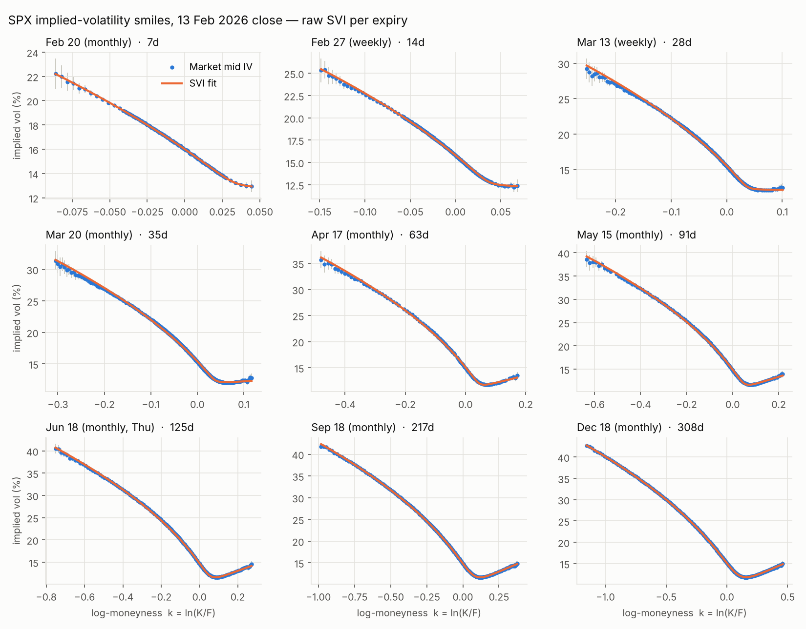
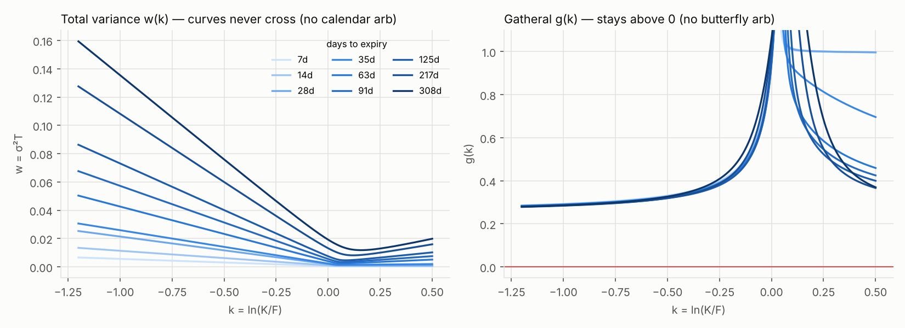
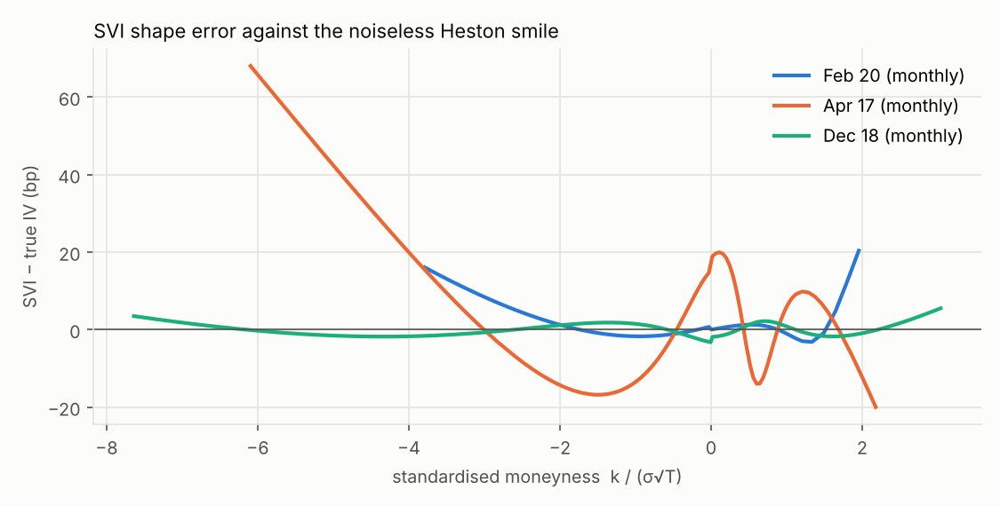
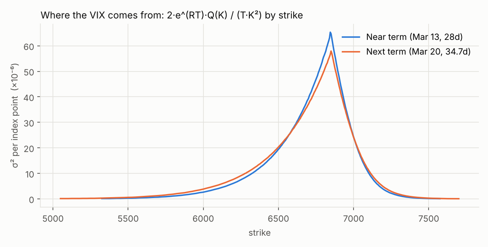
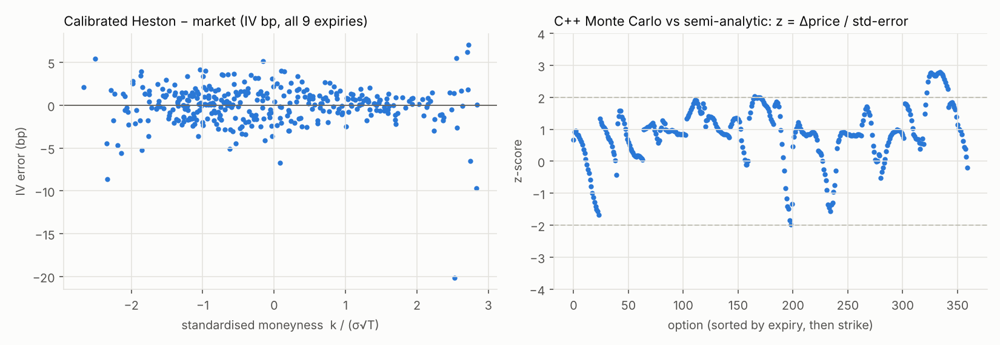

# SPX Implied-Volatility Surface — 13 Feb 2026 close

An end-to-end equity-index vol pipeline: option chain → implied vols → arbitrage-checked
SVI surface → VIX replication → Heston calibration with a C++ Monte Carlo pricer.

**Setup.** The snapshot is SPX at the close on Friday 13 February 2026 (spot 6,836.17,
r = 3.65%, q = 1.18% — illustrative). Because a vendor chain isn't redistributable, the
chain is **generated from a hidden Heston model** and then dressed up like a raw feed:
tick-rounded bids/asks, spreads that widen with price, zero bids in the wings, crossed
markets and stale quotes. The upside is that every stage has a ground truth to be graded
against. Swapping in a real chain only changes `volsurf/chain.py::generate_chain`.

```
python run_all.py          # ~35 s end to end, builds the C++ pricer on first run
python run_all.py --no-mc  # skip Monte Carlo
```

Requires Python 3.10+, numpy, scipy, pandas, matplotlib; g++ with OpenMP.

## Paper

**[paper/paper.pdf](paper/paper.pdf)** — *How Accurate Is a Volatility-Surface Pipeline? A
Ground-Truth Study of SVI Fitting, VIX Replication and Heston Calibration on SPX Options*
(13 pages). It writes up the pipeline below plus two experiments:

- **VIX error decomposition** across strike spacings 5–100 with 200 noise seeds each, and a
  derivation that the Cboe estimator's discretisation bias is ΔK²/(6TF²) in variance,
  independent of where the forward sits between strikes (measured/predicted = 1.01–1.04).
- **Heston identification** across 40 noise seeds: the full surface pins every parameter to
  <0.5%, but expiries ≤ 35 days leave κ and θ on a ridge (correlation −0.95), one cheap wing
  quote can move κ from 1.95 to 1.49, and Gauss–Newton standard errors understate the real
  dispersion by 1.4–3.1×.

To rebuild everything the paper quotes (≈ 8 minutes, mostly the two experiments):

```
python run_all.py
python experiments/vix_error.py
python experiments/calibration_stability.py
python experiments/outlier_diagnosis.py
python experiments/robustness_checks.py
python paper/build_assets.py          # figures, tables and every number in the text
cd paper && latexmk -pdf paper.tex
```

No number in `paper.tex` is typed by hand: they are LaTeX macros in
`paper/generated/numbers.tex`, written by `build_assets.py` from the experiment outputs.

## Results at a glance

| Stage | Check | Result |
|---|---|---|
| Chain → IVs | 4,092 raw quotes → 1,624 clean OTM IVs | median IV error vs truth **1.2 bp** (p95 9.8 bp) |
| SVI | butterfly (Gatheral g ≥ 0), Lee wings, calendar | **arbitrage-free on all 9 slices / 8 pairs** |
| VIX | replicated vs true 30-day variance-swap vol | **16.541 vs 16.543** (−0.002 vol pts) |
| Heston | recover hidden (v₀, κ, θ, σ, ρ) | **all within 0.2%**, 2.3 bp IV fit, ~2 s |
| C++ MC | 360 options vs semi-analytic | **94% within 2 s.e., all within 3**, ~8 s for 200k paths |

## 1. Chain, cleaning, forwards, implied vols

Nine expiries from 7 to 308 days, mixing PM-settled weeklies (SPXW, 4:00 pm) and
AM-settled monthlies (9:30 am SOQ). June's monthly expires **Thursday 18 June** because
19 June 2026 is Juneteenth. Year fractions are in calendar minutes, as in the VIX paper.

Cleaning drops 20 crossed markets, 408 zero bids and 16 stale/absurdly wide quotes.
Forwards come from put–call parity: regress C − P = DF·F − DF·K on near-ATM strikes.

Finding: **the forward is well identified, the discount factor isn't.** Forwards land within
0.4 index points of truth on every expiry, but the implied rate wanders from 1.5% to 4.6%
around the true 3.65% (worst at the 7-day expiry, where the slope barely moves). In
production you would take DF from the SOFR curve and solve only for F.

IVs are Black-76 on the parity forward, OTM side only (puts below F, calls above).

## 2. SVI per expiry + static-arbitrage checks

Raw SVI, `w(k) = a + b(ρ(k−m) + √((k−m)² + s²))`, fit in implied-vol space with
weights 1/(IV half-spread), multi-start, constraint `a + bs√(1−ρ²) ≥ 0`.



| Expiry | n | RMSE vs quotes | RMSE vs truth | inside bid/ask | min g(k) | max Lee slope |
|---|---|---|---|---|---|---|
| Feb 20 (7d) | 110 | 3.3 bp | 3.9 bp | 100% | 0.32 | 0.005 |
| Feb 27 (14d) | 166 | 7.4 | 8.5 | 93% | 0.31 | 0.010 |
| Mar 13 (28d) | 242 | 15.8 | 14.2 | 52% | 0.30 | 0.020 |
| Mar 20 (35d) | 271 | 16.1 | 16.6 | 45% | 0.30 | 0.024 |
| Apr 17 (63d) | 105 | 21.5 | 20.9 | 42% | 0.29 | 0.039 |
| May 15 (91d) | 132 | 18.7 | 17.9 | 46% | 0.28 | 0.052 |
| Jun 18 (125d) | 157 | 12.9 | 13.2 | 54% | 0.28 | 0.066 |
| Sep 18 (217d) | 202 | 6.2 | 4.1 | 99% | 0.27 | 0.097 |
| Dec 18 (308d) | 239 | 3.4 | 1.7 | 100% | 0.27 | 0.120 |

**Butterfly:** Gatheral's g(k) stays positive on the quoted range and 0.5 beyond it on every
slice (min 0.27), so the implied density is non-negative. **Lee:** wing slopes b(1±ρ) are far
below 2. **Calendar:** total variance is strictly increasing in T at every k from −1.2 to 0.5
(smallest gap 2.5×10⁻⁴, Mar 13 → Mar 20).



Finding: **SVI's misfit is model error, not fitting error.** The 1–6 month slices miss ~20 bp
and only half the fits sit inside the spread. A completely different optimiser (Zeliade
quasi-explicit) lands on the same parameters, and the error against the *noiseless* truth
is the same size as against the quotes. SVI is exact for Heston only in the long-maturity
limit (Gatheral & Jacquier 2011), and the error collapses at Sep/Dec; at 7–14 days the
quoted range is too narrow to expose it. The fix is SSVI or an extra degree of freedom per
slice, not more optimiser starts.



## 3. VIX replication (Cboe white paper)

Near and next terms are the expirations with 23 < days < 37: **Mar 13 weekly (28.0 d)** and
**Mar 20 monthly (34.7 d)**. Per term: F from the strike with the smallest |C − P|, K₀ the
first strike ≤ F, walk out from K₀ and stop after two consecutive zero bids, ΔK =
half-distance to neighbours, average call/put at K₀, then

σ² = (2/T) Σ ΔKᵢ/Kᵢ² · e^{RT} Q(Kᵢ) − (1/T)(F/K₀ − 1)²

and interpolate the two terms in minutes to 30 days.

| | strikes used | range | replicated | SVI continuum | true |
|---|---|---|---|---|---|
| Near (Mar 13) | 242 | 5,325–7,575 | 16.515 | 16.524 | 16.520 |
| Next (Mar 20) | 271 | 5,050–7,700 | 16.590 | 16.599 | 16.595 |
| **30-day VIX** | | | **16.541** | 16.550 | **16.543** |

The "published" number here is the model's exact 30-day fair variance,
E[(1/τ)∫v dt] = θ + (v₀ − θ)(1 − e^{−κτ})/(κτ). Two error sources are visible and partly
cancel: discrete strikes plus wing truncation cost ~−0.005 vol pts per term, and linear
interpolation of total variance in time (exact only if variance is flat in T) adds +0.003.



## 4. Heston calibration + C++ Monte Carlo

Calibration uses the semi-analytic Heston price (Lewis single integral, "little trap"
characteristic function, 600-node Gauss–Legendre) on 360 quotes thinned evenly across
each smile. The objective is (model − mid)/vega, a fast proxy for IV error.

| | v₀ | κ | θ | σ | ρ |
|---|---|---|---|---|---|
| hidden truth | 0.0262 | 2.100 | 0.0405 | 0.780 | −0.710 |
| calibrated | 0.0262 | 2.104 | 0.0405 | 0.780 | −0.710 |

Same answer from three very different starting points; RMSE 2.3 bp, which is the quote
noise floor. The Feller condition is violated (2κθ − σ² = −0.44), as it usually is for SPX,
so variance hits zero — which is exactly why the MC uses QE rather than Euler.

`cpp/heston_mc.cpp` prices every option off one set of paths: Andersen's QE scheme for
variance, his central discretisation for the log-forward, a time grid that lands exactly on
each expiry, OpenMP threads with per-thread RNG streams, and a martingale diagnostic
E[F_T/F₀] − 1 per expiry (all at noise level; the largest, 3.1×10⁻⁴ at 308 days, is
0.8 standard errors).

Calibration is semi-analytic and the MC is an independent repricing check — that's the
standard split. Calibrating directly on MC prices would need common random numbers and
~100 pricer calls; the C++ binary takes options and parameters on the command line so it
can be dropped into an optimiser if you want to try it.



Strikes in one expiry share paths, so z-scores move together within an expiry. The Dec
cluster near +2.7 with seed 7 is a single unlucky draw: across seeds 1–4 the largest
per-expiry mean z is 1.34, and with daily or weekly time steps it is 1.16 and 0.65, so
there's no discretisation bias (`experiments/robustness_checks.py`).

## Layout

```
volsurf/config.py     snapshot, expiries, hidden model
volsurf/bs.py         Black-76 price, vega, implied vol
volsurf/heston.py     characteristic function, Lewis pricer, fair variance
volsurf/chain.py      chain generator, cleaning, parity forwards, IVs
volsurf/svi.py        raw SVI fit, Gatheral g(k), Lee, calendar checks
volsurf/vix.py        Cboe VIX replication, SVI-continuum variance
volsurf/calibrate.py  Heston calibration
cpp/heston_mc.cpp     QE Monte Carlo pricer (OpenMP)
run_all.py            pipeline, figures, output/results.json
data/                 generated chain + IVs (CSV)
experiments/          VIX error decomposition, calibration stability, outlier
                      diagnosis, robustness checks -> output/experiments/
paper/                paper.tex, paper.pdf, references.bib, build_assets.py,
                      generated/ (macros + tables), figures/
```

## Next steps

- Replace raw SVI with SSVI (Gatheral–Jacquier) to get calendar-free-by-construction slices
  and close the 1–6 month misfit.
- Drop in a real chain (Cboe DataShop, or an OptionMetrics snapshot) and compare the
  replicated VIX with the published 4:15 pm print.
- MC calibration with common random numbers, then price something path-dependent
  (a variance swap with discrete monitoring, or a down-and-out put) that the
  semi-analytic pricer can't.
